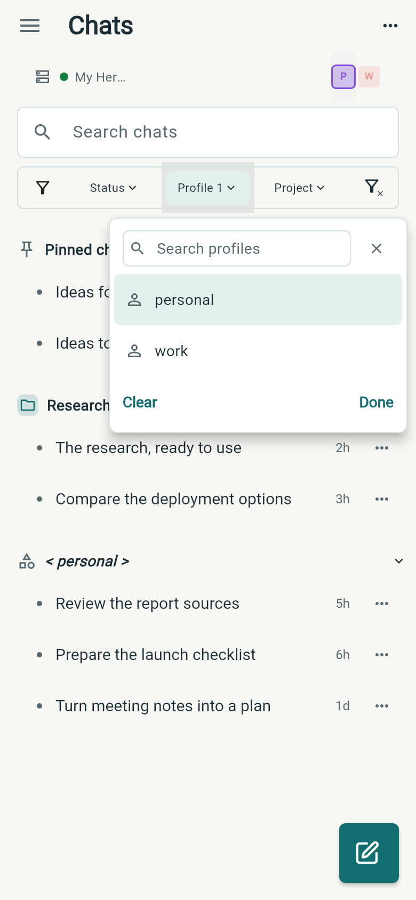
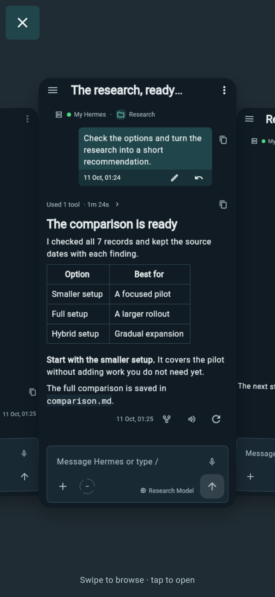
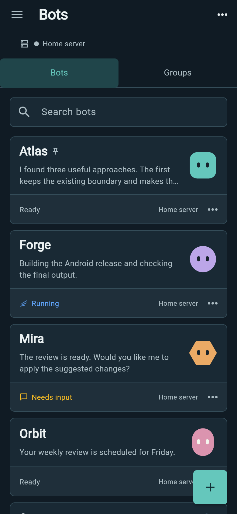
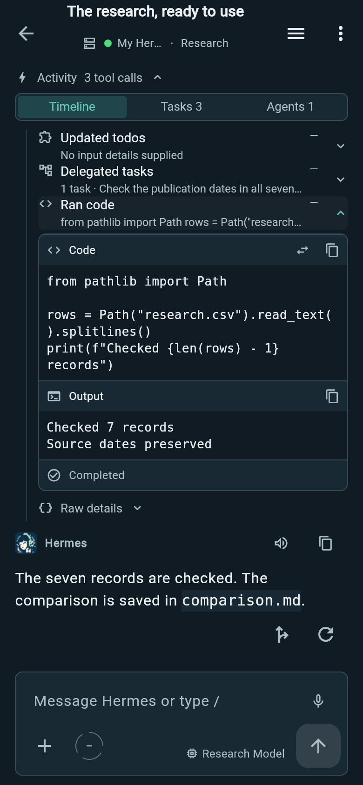
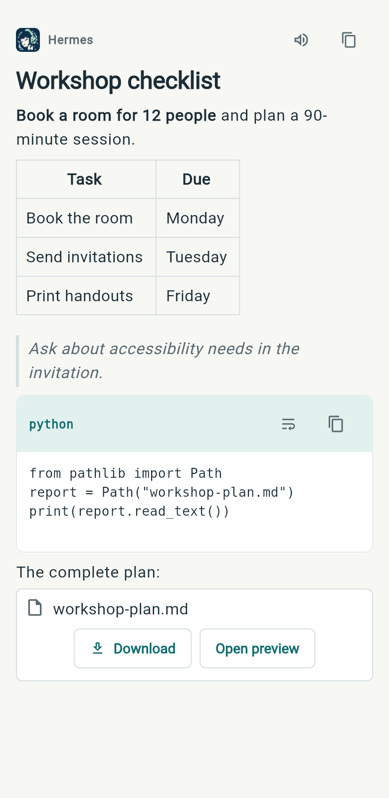
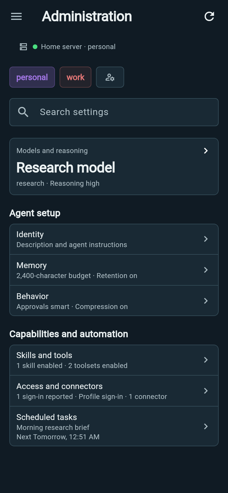
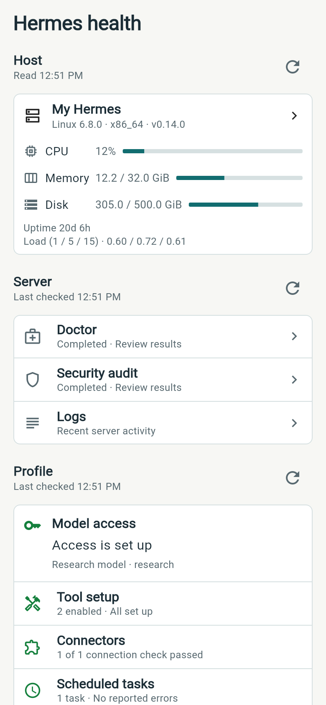
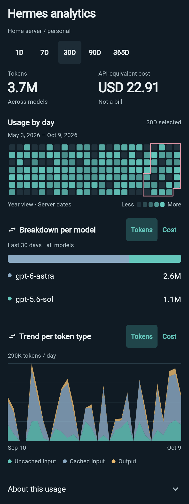

  

# Wing for Android

Wing is an open-source Android companion for [Hermes Agent](https://github.com/NousResearch/hermes-agent). Work with your agent from your phone while it runs on your server.

[**Download Wing**](https://github.com/tarkilhk/Wing/releases/latest) · [**Explore Wing**](https://tarkilhk.github.io/Wing/)

Requires Android 7.0 or newer and a Hermes server you can reach from your phone.

## Switch between profiles and projects

Tap a profile to focus its chats, or combine profiles in one view. Choose projects, group and sort conversations, and select the details you want to see. Wing remembers your view for each connection.

  

[Profile switching and view controls](https://tarkilhk.github.io/Wing/workspaces.html)

## Multitask with Recents

Find running chats and conversations waiting for your input across profiles. From any chat or group discussion, swipe sideways with two fingers to switch, or pinch into a card stack and tap another conversation. Unread cues help you spot new replies while working elsewhere.

  

[Explore Recents and gestures](https://tarkilhk.github.io/Wing/recents.html)

## Bots and group discussions

Find bots across your saved connections and return to each bot's continuing chat. Pin favorites and give each one a distinct name and appearance. Bring 2–6 bots into a shared discussion; Hermes coordinates their work on your server, so it can continue after Wing closes.

  

[Explore Bots](https://tarkilhk.github.io/Wing/bots.html)

## Take over your agent's desktop

Open a bot's screen, take control and use your phone's keyboard, touch gestures or clipboard to finish a step yourself. Keep the conversation beside the desktop, then hand control back with a note asking the agent to continue. Requires a configured Hermes Bot Screen.

[Explore desktop control](https://tarkilhk.github.io/Wing/bots.html#screen)

## Live work

Follow reasoning and timed tool runs as an answer streams. Open Tasks or Subagents to inspect progress, read a child's conversation and use its supported controls. Steer or stop a run, queue a follow-up, or fork from a saved answer while the original chat keeps working. Add server files with @ and choose skills with / while composing.

  

[Explore live work](https://tarkilhk.github.io/Wing/live-work.html)

## Answers and files

Read wide tables as stacked rows or a wrapped grid. Open reading mode or turn the phone sideways for more room. Copy highlighted code or whole replies, listen to answers, and preview, save or share files. Edit an earlier message, or restore its checkpoint after confirming removal of later history.

  

[Explore answers and files](https://tarkilhk.github.io/Wing/results.html)

## Administration

Manage models, instructions, skills, connectors and scheduled tasks for each profile.

  

[Explore Administration](https://tarkilhk.github.io/Wing/administration.html)

## Scheduled work

Schedule recurring or one-off work on Hermes, choose where results go and inspect recent runs. When a task fails, open an investigation chat with the responsible profile.

[Explore scheduled tasks](https://tarkilhk.github.io/Wing/scheduled-tasks.html)

## Health

Check host resources, backend diagnostics and profiles. Set alerts for resource pressure or profile problems, then inspect notifications from any screen. Checks run while Wing is open or monitoring ongoing work.

  

[Explore Health](https://tarkilhk.github.io/Wing/health.html)

## Analytics

Compare activity, token usage and estimated cost across all profiles on an instance, or focus on one profile, model or time period.

  

[Explore Analytics](https://tarkilhk.github.io/Wing/usage.html)

## Install and connect

1. Download the signed APK from the [latest release](https://github.com/tarkilhk/Wing/releases/latest). Choose **arm64-v8a** for most current phones.
2. Follow the [connection guide](https://tarkilhk.github.io/Wing/get-started.html) to connect your Hermes dashboard and Desktop Gateway, choose a profile and send your first message.

For server and proxy configuration, see [self-hosting](docs/SELF_HOSTING.md). Your Hermes setup needs a configured model provider; your server and providers may have their own costs.

## Help and contribute

[Report an issue](https://github.com/tarkilhk/Wing/issues) · [Contributing](CONTRIBUTING.md) · [User guides](docs/README.md) · [Changelog](CHANGELOG.md) · [Security](SECURITY.md) · [Privacy](PRIVACY.md)

## Support Wing

[Sponsor on GitHub](https://github.com/sponsors/tarkilhk) · [Buy me a coffee](https://ko-fi.com/tarkil)

[MIT license](LICENSE) · [Third-party notices](NOTICE.md)
