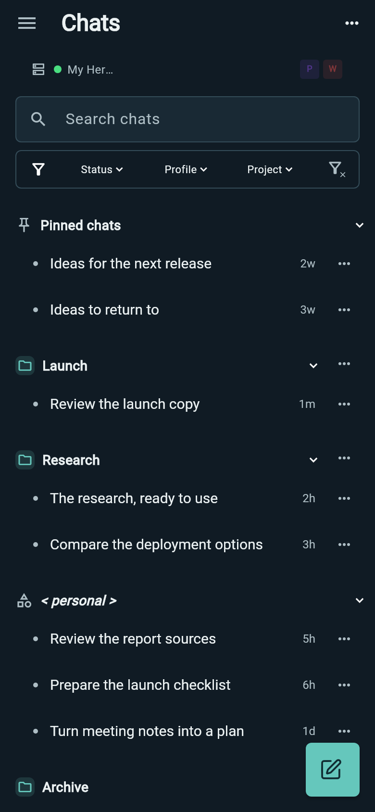
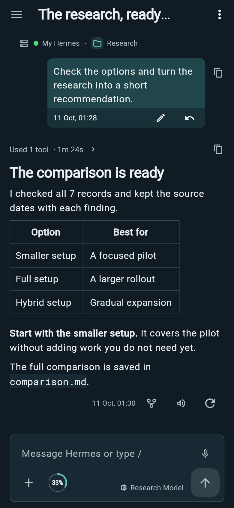
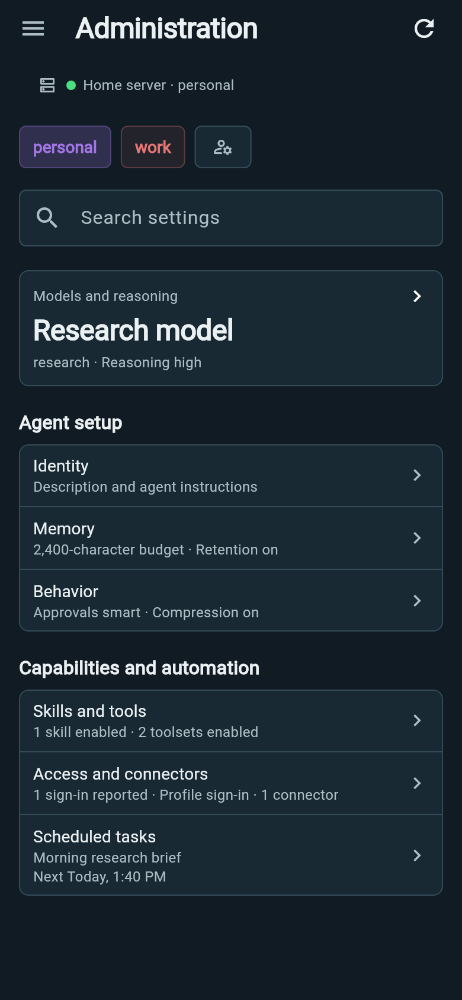

# Explore Wing

Choose **Chats** in the navigation menu to return to the chat list, including
from an open conversation or Recents. Your unsent draft is kept for when you
reopen the conversation.

Every conversation uses the same chat menu: **View screen**, **Outputs**,
**Find in chat**, and **Refresh workspace**. Child conversations also offer
**Parent chat**. Goal, agents and background work are available through the
conversation's **Activity** entry.

**Refresh workspace** shows Wing's pulsating feathers in the top-right header
until the refresh finishes. Your conversation and draft remain available;
the menu item is disabled while that refresh is pending.

While a chat opens, the Wing pulse in the header shows loading progress and you
can continue writing your draft.

**View screen** opens the remote desktop for the conversation's connection and
profile, including ordinary chats. Chats in the same profile share that screen.
Opening it does not start the desktop or create a canonical Bot Chat. Back returns
to the same conversation.

**Your agent, with you.** Wing keeps Hermes close when you step away from your desk. Start a conversation, check progress, send the next idea and look after your setup from Android. [Get started](GETTING_STARTED.md).

## Pick up where you left off

  
  

- **Find the right chat.** Search, pin and group conversations; filter by profile, project or status. The Project filter lists projects and unassigned-chat groups belonging to the selected profiles; clear the Profile filter to see all profiles' projects. Recents shows chats and bot discussions with messages from the last 24 hours alongside ongoing work, ordered by the last message. Compact cards show identity, running/input status, a green New answer cue for unread replies, and age. Bot chats use their saved name and avatar; ordinary chats show their project, or “No project”, and colored profile marker. Swipe left or right with two fingers from any chat or bot group to switch conversations. Pinch inward to browse Recents cards and tap one to open. Neither gesture requires opening Recents first. Swipes can travel diagonally: only left/right movement counts, regardless of vertical drift. Chats opened through Recents already have the mode enabled. If there are no other recent chats, your current chat remains the only card; loading and failed reads have separate feedback with a retry action. Soft edge cues indicate replies (white in dark mode, charcoal in light mode) or confirmed requests for input (amber). Back closes the card stack first. Back from an open conversation then returns to its canonical list: Chats for ordinary chats, Bots for bot chats, or Groups for discussions. Earlier conversations opened while switching are cleared from the navigation stack. The mode lasts until you leave the chat workspace. Recents shares a cached list and screenshots across visits, with background refreshes. On its initial load, Recents keeps the header Wing pulsing until chats, bots, groups and their admitted artwork finish loading; cards already received remain usable. Later automatic refreshes stay quiet. Loading feedback on Recents and Bots does not move the list. A failed group or profile refresh keeps known entries available and reports an error.
- **Keep browsing after changes.** Chat and project actions apply when Hermes confirms them. Long press the New chat button to reveal New project above it. Choose its name, folder, color and icon together, with a live appearance preview. New project creates its chosen folder on Hermes before saving the project and its appearance; an existing folder is reused. Creation shows progress and keeps your draft available after a failure. Folder errors stop creation and appear in Wing. The list then refreshes quietly in the background, keeping search, token counts and reading position available. Wing's feather pulse indicates blocked loading without moving the screen. Usable screens refresh automatically without a loading animation. Explicit Refresh group shows the same pulse until its read settles. Action buttons and tool/process/agent category icons keep their identity while work is pending. History paging and answer changes use the fixed header slot without shifting content. One feather pulse in the conversation status shows confirmed agent work while you can still read, write, stop or steer. During a manual refresh, ongoing work keeps pulsing and the header shows a refresh symbol. Independent running bots and conversations keep their work indicators. Category icons stay visible, and individual components use their usual loading indicators. Retry stays above the scrolling list if a read fails. Retrying a refresh does not repeat the action.
- **See skill changes.** Expand Managed skills to see each reported skill, modified filename and action. Tap the filename for its full path. Exact tool output stays in Raw details.
- **Read the whole story.** Follow streamed replies, code, tables, tool activity and available reasoning. Python, shell commands and other identified source languages have syntax coloring in chat, Activity and file previews, with exact selection/copy and wrapping. Use the wrap icon beside Copy to switch code between wrapped lines and horizontal scrolling, including in the full Activity code viewer. Large and dense source blocks color within the visible viewport. Live code stays plain until the response finishes; unsupported or unlabelled source stays plain, and coloring failures preserve readable text. Find a message in a chat, open a result, or return to the latest reply.
- **Understand each action.** Open Activity → Timeline for readable call titles,
  targets, exception notices and available timings, with native reasoning between calls. Expand a call for its request
  and reported result: code/output, file content, Find/Replace and returned diffs,
  images/questions, search matches or readable tool data. Icon actions copy exact
  text, preview or share files/images, expand long previews, open a full view and wrap code; explanation text
  supports Markdown. Raw details retains selectable, copyable inputs and output.
  Skill-update batches show each operation's action, affected file when supplied
  and reported success.
  Live elapsed counters start only from a backend tool start; saved timing appears
  only when available. See [tool activity](TOOL_ACTIVITY.md).
- **Stay oriented.** See the selected model, context percentage inside its ring and current work. While Hermes compresses the conversation, the status above the composer shows “Summarizing conversation…” until work resumes or compression finishes. Tap the ring for a compact breakdown of used/max tokens, estimated context categories and available compression count. Switch models with a clear confirmation when Hermes warns about the change.

## Keep work moving

- **Talk to your bots.** Long press a profile icon in the Chats header to open its Bot Chat directly. Open Bots in the side menu for a compact roster across saved instances. Switch between Bots and Groups, keep pinned rows at the top, and see the last message from each bot's continuing chat. Tap its name or preview to chat, or its avatar to edit name and appearance. Valid appearance edits save automatically. The row menu offers View screen, Pin/Unpin, Hide/Show and Bot settings; settings opens role, instructions, model, accounts, tool editors and MCP connectors, plus duplication and advanced profile management. In an open Bot Chat, tap the header avatar or name to reach the same settings. Hosted Discussion groups bring 2–6 bots from one ready instance together, with mentions, approvals, stop and recovery controls. [Bots and current desktop differences](BOTS.md).

- **Choose your model.** Browse a compact provider-filtered list and open model cards for supplied prices and account usage. OpenAI API and Codex choices share models.dev API rates; Codex labels them as API-equivalent. Account usage retains each account's reported windows. The small brain control selects reasoning; lightning toggles fast mode where available. In the composer, tap the short model name to open the picker, tap lightning to toggle fast, or hold thinking, slide to a level and release to apply; slide away to cancel. Picker changes wait for Apply.
- **Choose what happens next.** Send a new message, steer active work, queue a follow-up or stop it. An empty composer shows Stop while work is running; start typing to restore the send arrow and your usual held-action order. Hold, slide and release to choose another action. Edit a queued item before it sends. Drafts and staged files survive navigation and restart.
- **Run commands in chat.** Type `/` at the start of the composer, choose a command and send it. If a command times out or loses its connection, Wing keeps the invocation and reports an uncertain result. Check what changed on Hermes before repeating it.
- **Use a skill while writing.** Type `/` after a space, punctuation or on a new line anywhere in your message to open the skill helper. Tap its refresh icon to reload installed skills from Hermes and update the suggestions. Tap a skill’s eye icon to inspect its instructions in the skill viewer without changing your draft. Tap the row to insert its name in bold accent text. At the start of a message, the helper also offers native commands. Recognized command names use accent-colored monospace in the composer, with arguments in ordinary text. Suggestions label entries as Skill or Command. Commas, periods, quotes and brackets around the name preserve the skill reference; hyphens and underscores stay part of the name. Plugin skills such as `/mattpocock-skills:writing-for-agents` use the full name, including the colon. Keep writing, then Send to load its instructions with your message.
- **Explore another direction.** User messages sit at the right with time and actions in a compact tinted footer. Edit a saved message, or use Restore in its footer to confirm removal of later history and rerun that prompt. Restore preserves your separate draft and pauses queued follow-ups. Fork from a selected saved answer into a separate conversation, or regenerate it in place. Fork is not a send-menu choice. Your Hermes server keeps the authoritative history.
- **Follow delegated work.** In Activity → Tasks, read full task text with explicit status and subtask indentation. In Agents, see each goal, current activity and available timing; tap for live output, backend details and supported controls. Saved task and delegation results restore these tabs in past chats; historical agents expose output and delivered durations without live controls.
- **Respond from your phone.** Review supported approvals and questions, inspect subagents and goals, and use local notifications for replies and requests while Wing is running. Group monitoring follows the shared discussion, and its latest reply replaces the group notification. Each chat keeps one latest read-only notice while unresolved input requests remain pending.

## Use what is already on your phone

- **Bring files and ideas.** Attach a photo or file, take a picture inside a chat, or review content shared from another Android app before sending it to Hermes. Images sent from Desktop also appear in saved chats; tap a thumbnail to open its original.
- **Open useful results.** Images appear inline in replies, with a compact download control and tap-to-zoom using the original. Preview PDFs, Markdown, diagrams and supported media. File cards place a download arrow and preview eye beside the filename. Save or share output files through Android.
- **Talk when typing is awkward.** Dictate into an editable draft and read a reply aloud. Choose on-device or Hermes processing separately for input and output in App settings.

## Run your Hermes setup

  
  

Switch between connections and profiles. Manage supported model settings, provider access, MCP connectors and server-run scheduled tasks. Health and diagnostics help you find setup problems; analytics shows activity, tokens and model breakdowns. Supported controls depend on your Hermes server and profile.

The title-row warning triangle warns about issues affecting Hermes while Wing is open or
already monitoring work. Tap it for one issue at a time. Configure device-local
thresholds under **Hermes health → Alert settings**; RAM and disk warnings start
above 90% for two minutes and clear below 85% for two minutes. Valid settings
save automatically. Separate native-pressure toggles admit Hermes's critical
memory and disk reports immediately. [Health alerts](ADMINISTRATION.md#health-alerts)
explains recovery and investigation. Closing the alert dialog leaves unresolved
issues visible in the alert icon until you acknowledge or snooze them. Use the
checkmark to acknowledge an occurrence or the snooze icon to pause its cues for
30 minutes. Acknowledged and snoozed issues are available under **Hermes health
→ Health alerts**; they do not appear in the header icon or its count. Snooze
expiry, escalation or recurrence alerts you again.

## Make it yours

Choose a light or dark theme, accent color and text size with a live preview. Back up your connections and app preferences, with an optional passphrase. Quick Chat, Recents and Search chats are also available from Wing's Android launcher shortcut menu.

[Get started](GETTING_STARTED.md) · [Good to know](KNOWN_LIMITATIONS.md) · [All guides](README.md)
